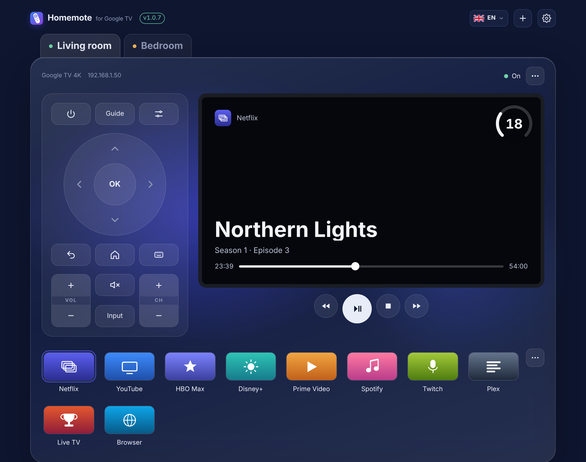
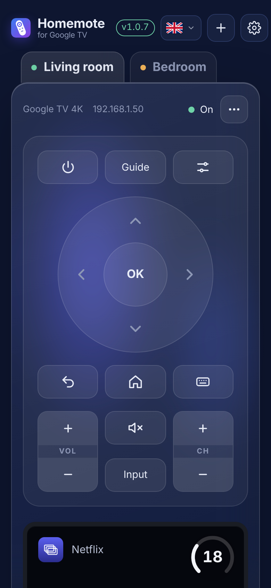
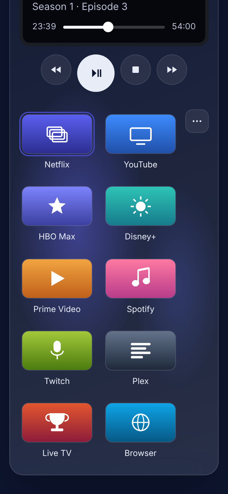
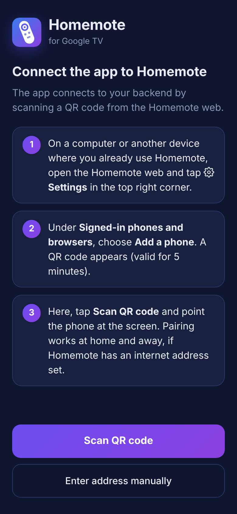
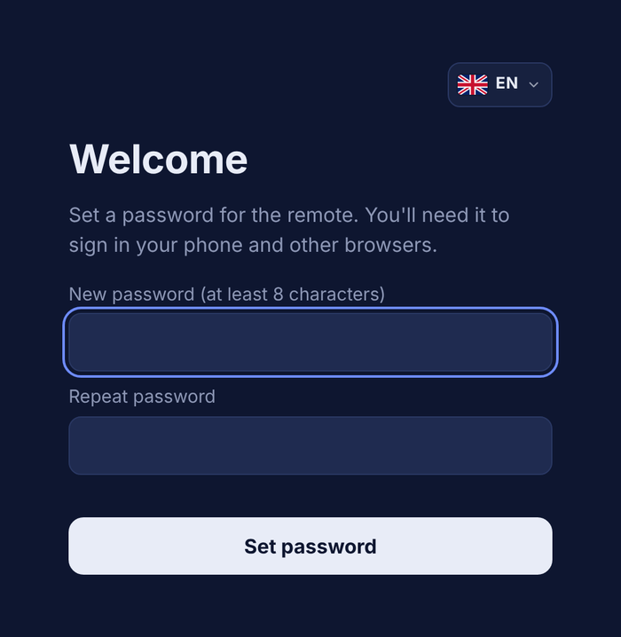
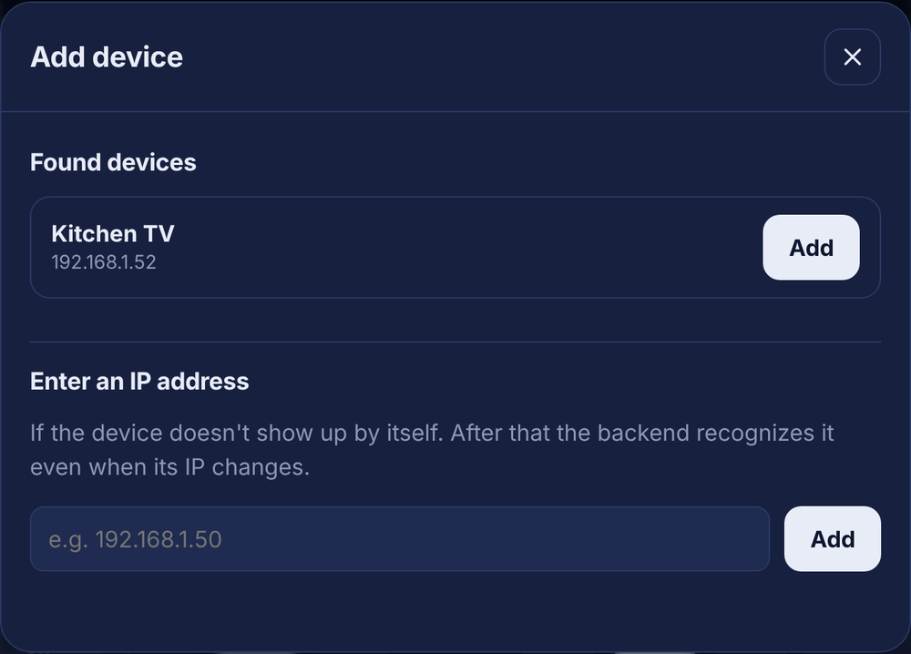
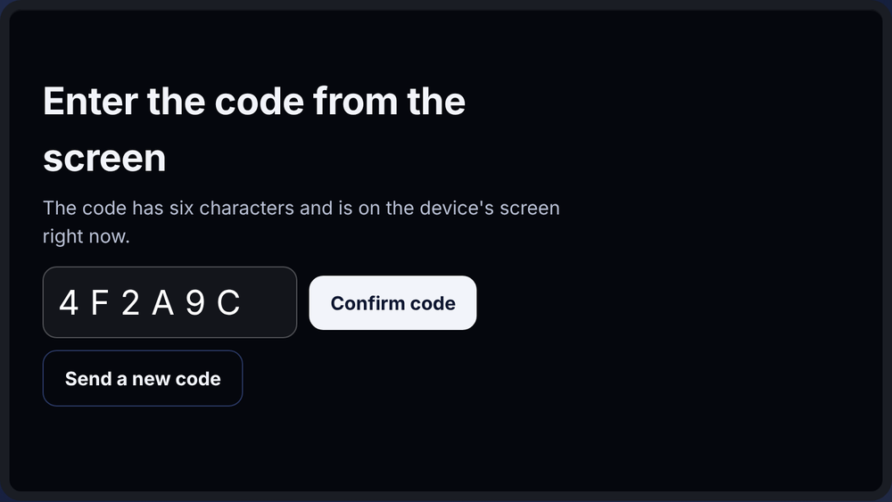
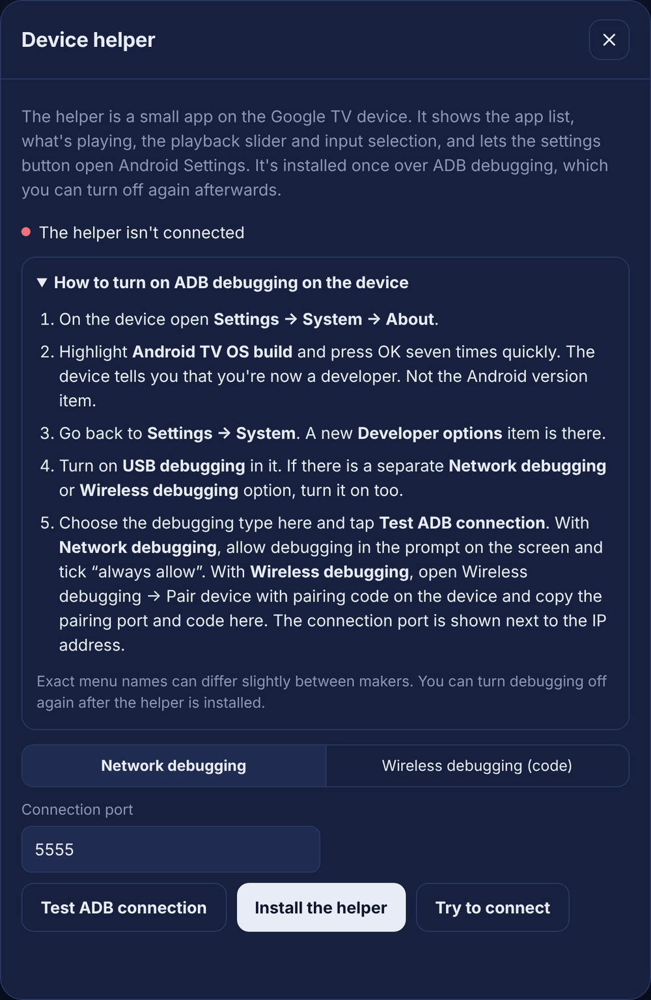
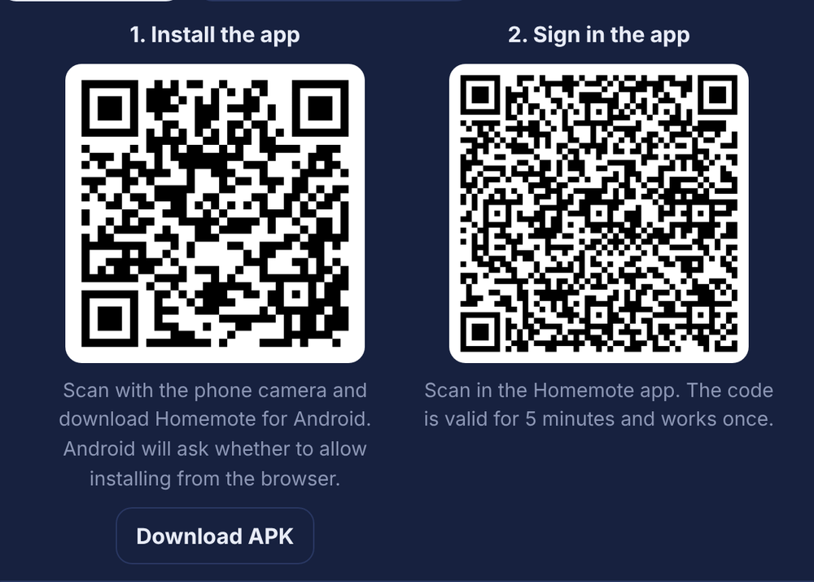

# Homemote for Google TV

**A remote control for your Google TV / Android TV that runs at home, on your own server.** Use it from any browser or from the Android app: change channels and volume, type text, launch apps, see what's playing and skip through it.



<p align="center">
  
  &nbsp;
  
  &nbsp;
  
</p>

## Download

| What | Link | Do I need it? |
|---|---|---|
| **Homemote** (server, Docker image) | `ghcr.io/tlkounev/homemote-backend:latest` | **Yes**, see [Install](#1-install-homemote) |
| **Android app** for your phone | [homemote.apk](https://github.com/tlkounev/homemote/releases/latest/download/homemote.apk) | Optional. You can also use any web browser. |
| **Helper** for the TV | [helper.apk](https://github.com/tlkounev/homemote/releases/latest/download/helper.apk) | Optional. Homemote installs it on the TV for you, you don't need to download it. |

All versions and what changed: [Releases](https://github.com/tlkounev/homemote/releases) · [Changelog](CHANGELOG.md)

## What it can do

- **The usual remote:** arrows and OK (hold OK for the context menu), back, home, volume, mute, channels, power, input selection.
- **Typing:** type on your phone or computer instead of the on-screen keyboard. Works in Google's keyboard and also in apps with their own keyboard (needs the helper setup).
- **Apps and playback** (with the helper on the TV): your apps as tiles, what's playing right now with a slider to skip.
- **Several TVs** in tabs, colour shows the state: 🟢 on, 🟠 standby, 🔴 unreachable.
- **Phone app** for Android: pairs by scanning a QR code, works at home and away, the phone's volume buttons control the TV.
- **15 languages**, light and dark mode.

## What you need

- A **Google TV or Android TV** device (TV, set-top box, streaming stick) in your home network.
- A computer that is **always on** and runs **Docker**: a home server, a mini PC or a NAS with Docker support (Linux, x86-64 / Intel or AMD).
- Optional: an **Android phone** for the app. Any phone, tablet or computer can use the web version.

## 1. Install Homemote

Create an empty folder (for example `homemote`), put this file in it as **`docker-compose.yml`** ([download](docker-compose.yml)):

```yaml
services:
  homemote-backend:
    image: ghcr.io/tlkounev/homemote-backend:latest
    container_name: homemote-backend
    restart: unless-stopped
    network_mode: host        # needed so Homemote can find your TVs
    volumes:
      - ./data:/data          # your settings are stored here
    environment:
      PORT: "888"             # web address port
```

Then, in that folder, run:

```sh
docker compose up -d
```

If your NAS has a Docker app with a "create application / stack" screen, you can paste the same text there. Change `./data` to a folder on your NAS, for example `/share/homemote/data`.

<details>
<summary>Without Compose (one command)</summary>

```sh
docker run -d --name homemote-backend --restart unless-stopped \
  --network host -v "$PWD/data:/data" -e PORT=888 \
  ghcr.io/tlkounev/homemote-backend:latest
```
</details>

## 2. Set a password

Open **`http://<address of your server>:888/`** in a browser **at home** (for example `http://192.168.1.10:888/`) and choose a password. You'll need it to sign in other browsers and phones.



For security, the password can only be set from your home network.

## 3. Add your TV

Turn the TV on. Homemote finds it by itself within a few seconds and the **+** button at the top starts to blink. Click it and choose **Add**.



If your TV doesn't show up, type its IP address in the same window (you'll find it on the TV in *Settings → Network*).

## 4. Pair it

Click **Pair**. The TV shows a six-character code. Type it in and confirm. Done, the remote works.



## 5. Optional: the helper on the TV

The helper is a small app that Homemote installs on the TV. Without it the remote works too, but with it you also get the **app tiles**, **what's playing** with a slider, **input selection** and a working **settings** button.

Open it under the app section **⋯ → Device helper** and follow the steps: turn on *developer options* and *debugging* on the TV, click **Test ADB connection** and then **Install the helper**. You can turn debugging off again afterwards.



## 6. Optional: the phone app

In Homemote open **⚙ Settings → Signed-in phones and browsers → Add a phone**. Two QR codes appear:

1. **Scan the first one** with the phone's camera and download the app. Android asks whether to allow installing apps from your browser, allow it.
2. **Open the app** and tap **Scan QR code**, then scan the second code. The app signs in by itself.



Want to use Homemote outside your home? You need your own **reverse proxy** with a valid HTTPS certificate (full certificate chain). Then enter its address in *Settings → Backend addresses*. The proxy has to pass WebSockets (`/api/ws`).

## Updating

The version is shown next to the title: **green** = up to date, **red** = a new version is available (click it to see what's new). To update:

```sh
docker compose pull && docker compose up -d
```

Your settings, TVs and signed-in phones stay. Homemote checks GitHub for a new version every 6 hours (anonymously, turn it off with `HM_UPDATE_CHECK=0`).

<details>
<summary>Automatic updates with Watchtower</summary>

Homemote doesn't update itself (it would need full access to Docker, which isn't a good idea for something reachable from the internet). For hands-off updates, run [Watchtower](https://github.com/nicholas-fedor/watchtower) (the maintained fork; the original `containrrr/watchtower` was archived in December 2025) next to it, limited to Homemote with a label:

```yaml
services:
  homemote-backend:
    image: ghcr.io/tlkounev/homemote-backend:latest
    # … rest as above
    labels:
      - com.centurylinklabs.watchtower.enable=true   # only this container is updated

  watchtower:
    image: nickfedor/watchtower:latest
    container_name: watchtower
    restart: unless-stopped
    volumes:
      - /var/run/docker.sock:/var/run/docker.sock
    environment:
      WATCHTOWER_LABEL_ENABLE: "true"     # ignore containers without the label above
      WATCHTOWER_SCHEDULE: "0 17 4 * * *" # daily at 04:17 (6 fields, seconds first)
      WATCHTOWER_CLEANUP: "true"          # remove the old image after an update
      TZ: Europe/Prague                   # time zone for the schedule
```

Watchtower itself has full access to Docker. If your Docker host manages containers through its own app (some NAS systems), check how it copes with containers recreated outside of it.
</details>

## Problems?

<details>
<summary>The TV isn't found</summary>

- The TV and the server must be in the same home network, and the TV must be on.
- Homemote must run with `network_mode: host` (see step 1). Docker Desktop on Windows and macOS can't find TVs automatically; add the TV by IP address there.
- Add it manually with **+** → IP address.
</details>

<details>
<summary>The TV is "unreachable" (red) while in standby</summary>

Some TVs switch off their network completely in standby, then nothing can reach them over the network. On the TV look for settings like *Switch on with Wi-Fi / Chromecast* or *Network standby*. A very short DHCP lease on your router (for example one minute) can also cause it, set it to hours.
</details>

<details>
<summary>Typing doesn't work in some app</summary>

Some apps (often streaming apps) have their own on-screen keyboard. Homemote can type into those too, but needs the debugging connection set up in the helper window (step 5).
</details>

<details>
<summary>The phone app can't connect from outside</summary>

Check that your reverse proxy sends the **full certificate chain**. Chrome forgives a missing intermediate certificate, the Android app doesn't. The app shows the exact error.
</details>

<details>
<summary>I forgot the password</summary>

Stop Homemote, delete the file `data/auth.json` and start it again. All phones and browsers are signed out and you set a new password (from home). Your TVs and pairings stay.
</details>

<details>
<summary>Own IP address for Homemote (macvlan)</summary>

```yaml
services:
  homemote-backend:
    # … as in step 1, without network_mode
    networks:
      lan:
        ipv4_address: 192.168.1.20      # outside the DHCP pool
networks:
  lan:
    driver: macvlan
    driver_opts: { parent: eth0 }        # the server's network interface
    ipam:
      config:
        - subnet: 192.168.1.0/24
          gateway: 192.168.1.1
```

With `macvlan` the server itself can't reach the container unless you add a macvlan interface on it too; all other devices can.
</details>

## For developers

Building, releases, signing keys and the project layout: [docs/development.md](docs/development.md). HTTP/WebSocket API: [API.md](API.md).

## License

[Apache-2.0](LICENSE). The phone app bundles [jsQR](https://github.com/cozmo/jsQR) (Apache-2.0).

Homemote is not affiliated with Google. Google TV and Android TV are trademarks of Google LLC. App names in the screenshots (Netflix, YouTube, HBO Max, Disney+, Prime Video, Spotify, Twitch, Plex) are trademarks of their owners and are shown only to illustrate the app list; the tile images are placeholders.
